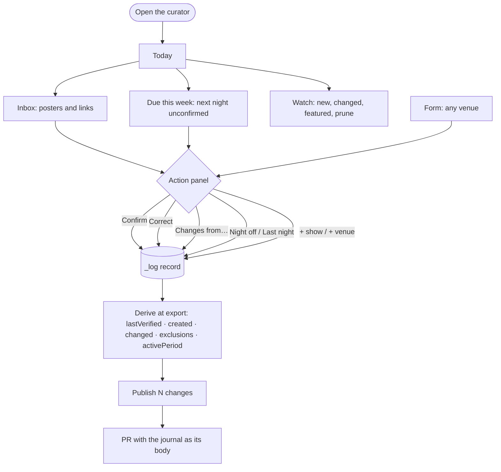

# Spike: One flow for keeping the directory current

> **Status:** Accepted with changes (see "Decided"). Follow-up tickets filed
> **Date:** 2026-10-14
> **Type:** Spike (research and design)
> **Ticket:** #327
> **Related:** ADR-015 (one confirmation per show date), ADR-016 (lifespans), ADR-017 (day-card sections), #276 (posters), #322 and #323 (`created`, `featured`), #324 (sections on by default)

## The question

How should the curator work for someone who keeps the directory current week
after week? And what data does that flow need, so the site can say three
things it is about to start saying publicly: a show is **new**, it **changed**,
and when it was **last verified**?

## The person doing the work

You run the directory alone, a few minutes a day. Assume every show gets vetted
about once a week, and you check a few each day. In a typical week you will:

- **Catch up.** Venues post fliers in Facebook groups. You paste them in, match
  each one to its show and confirm it. Most confirmations come from here.
- **Check the quiet ones.** Some shows never post. For those you call, look at a
  website, or go there yourself.
- **Fix what's wrong.** A start time was always 8, never 9. That's a correction.
- **Record what's changing.** "From Nov 6 we're on Thursdays." That's a change on
  a date.
- **Take a night off the calendar.** "No karaoke on the 31st."
- **Add and end things.** A new venue, a new night at an old venue, a show that
  stopped.
- **Publish**, several times a week.

The numbers behind "a few a day": there are 138 recurring shows, 122 of them
weekly. That's about 17 show nights on any given weekday. Posters will cover
most of them. Your hand checks only need to fill the gaps.

## What's there today

| Where | What you can do | What it writes |
|---|---|---|
| **Form** (the start screen; opens on "Pick a venue") | Edit any field in place | The field. **Nothing records that it changed** |
| | ✓ next / ✓ Verify all shows today | A record confirming the next night |
| | 📣 panel | A record (date, text, source, image) |
| | Lifespan panel → Split | Ends the old show, opens a copy |
| | ☆ feature panel, "+ Add schedule entry" | `featured`; `created` stamped today |
| **Dashboard**: 7 report tabs (Venues, Shows, Needs sources, Overdue, Never verified, Announcements, To prune) | ✓ and ✓ all (tooltip says "Stamp today's date") | A record confirming the next night |
| | Remove (on To prune) | Deletes the show; its records are kept |
| **Posters** | Confirm a ticked show for a night | A record (poster image, source) |
| | ✎ Correct it / Changes from… / No show that night | An edit / a Split / an exclusion, then Confirm |
| | + show / + one-time / + New venue | A new entry with `created` |
| **Header** | Save, Export, Publish… | Four buttons for one intent |

What the master holds today: 23 evidence records covering 17 of 150 shows (16
with an image, 4 with a source link, 3 with nothing but a date). The records
are bursty: 15 of the 23 were made on Oct 10.

## Where it breaks

1. **There's no front door.** The curator opens on an empty Form. It never says
   what needs doing today. The to-do list exists, but it's spread across seven
   report tabs that don't agree on what "due" means.
2. **"Confirm" lives in six places, labelled three ways.** You can confirm from
   the Form row (✓ next), the Form footer (Verify all), the 📣 panel, the
   Dashboard (✓, ✓ all) and Posters (Confirm). The Dashboard's tooltips still
   say "Stamp today's date", but since ADR-015 they confirm the *next night*.
   All six paths write the same record, but nothing tells you that.
3. **A change and a correction leave different traces, and an edit leaves none.**
   A Split leaves two entries and an `activePeriod`. A Posters correction leaves
   a confirmation. Editing the time in the Form leaves nothing, and you can't
   tell it was ever different. So "when did this show change?" can't be
   answered, and the site can't say "now on Thursdays".
4. **Three clocks.** On the site, a show is in Verified for **30** days (#320).
   The curator flags a show as overdue at **60** (a per-browser setting with 30,
   60 and 90 as options). The validator and the `?fresh=1` lens both use **60**.
   So a show drops out of Verified on the public site a full month before the
   curator calls it overdue.
5. **New is half-derived.** `created` is stamped when something is added
   (#323), but it's a stored field you could edit or lose. Meanwhile
   `lastVerified` has been derived from records since ADR-015. The same idea
   should cover both.
6. **Publishing takes four buttons.** Save, Export, then Publish in a dialog
   with its own buttons. Each step can be done out of order, and the PR says
   nothing about what changed.
7. **Sources are kept in two unrelated places.** Each venue has a
   `_curatorMeta.source` (3 of 85 venues use it). Each record also has its own
   `source`. The "Needs sources" tab counts the first, but only the second is
   evidence about a show.

## Proposal

The pattern ADR-015 already uses for `lastVerified` is the right one. Extend it
to everything. **Every action writes one record to a journal, and every public
date is derived from the journal.** Then build the screens around the journal:
one home screen that lists what's due, one action panel used everywhere, one
clock, and one publish button.

### A. One journal, every date derived

The master's `_announcements` becomes **`_log`**. It stays curator-private and
is never exported, exactly as now. One record per thing that happened:

```js
_log: [
  { id, at: "2026-10-14",            // the day you did it (was `seen`)
    kind: "confirm",                 // see the table below
    show: "sh-…",                    // the entry's private _id (or venue: "<id>" for venue-level kinds)
    for: "2026-10-16",               // the night it is about, when it is about one
    source, image, text,             // the evidence, as now
    was, now }                       // correct/change only: the fields before and after
]
```

| Action, wherever you take it | Kind | Public effect, derived at export |
|---|---|---|
| Confirm a night (poster, link, call, ✓) | `confirm` | `lastVerified` = the latest `for` |
| Fix a wrong fact | `correct` | Also confirms the next night: you just looked. **Not** news, so no `changed` |
| Change on a date (Split) | `change` | The new entry gets `changed` = the night it takes effect, and its `activePeriod.start` |
| Add a venue, show or one-time event | `add` | `created` = the date of the `add` record |
| Night off | `off` | An `exclusions` entry |
| Last night | `end` | `activePeriod.end` |
| Note (no night) | `note` | Nothing. Kept as context |

**One new public field:** `changed: "YYYY-MM-DD"` on a schedule entry. It's the
night the current version took effect. It's written only by a `change`, never by
a correction, and it gives the site something true to say: "Now Thursdays (from
Nov 6)". Everything else the site needs already exists. The difference is that
these dates are now derived from the journal, never typed:

| Public field | Today | Proposed |
|---|---|---|
| `lastVerified` | Derived from records | Unchanged (also counts `correct` and `change`) |
| `created` | Stored, stamped on add | Derived from `add` records |
| `changed` | — | **New**: derived from `change` records |
| `activePeriod` | Stored, set by hand or by Split | Unchanged storage, but every change to it writes a record |

**Why derive, again:** a derived date can't drift away from its evidence. It
can't be typed wrong, and a stale export can't revert it (the #229 and #237
lesson). And the journal is the changelog for free: "what happened since the
last publish" is a filter over `_log`.

**Migration:** rename `_announcements` to `_log`, with `seen` → `at` and
`kind: "confirm"`. A record with no `for` becomes `kind: "note"`. Synthesize
`add` records for the 7 dated records from #322. Nothing in the public file
changes until `changed` first appears.

### B. One home screen: Today

The curator opens on **Today**, not on an empty form:

1. **Inbox.** Posters and links waiting to be read, with the count and the
   oldest age. Opens Posters, unchanged.
2. **Due this week.** Every show whose **next night falls within 7 days and isn't
   confirmed for that night**, soonest night first. That definition is the
   weekly cadence: a show confirmed by a poster drops off the list by itself,
   and Thursday's shows come due on Thursday's schedule, not all at once. Each
   row carries the action panel (C). The list starts with **never-verified**
   shows and those about to leave the site's Verified section (day 25+ of 30).
   There is no daily target, by the owner's decision.
3. **Watch.** Informational, not tasks:
   - New in the last 30 days, and changed in the last 30 days, so you can check what the site is saying
   - Featured windows starting or ending this week
   - Shows to prune
4. **Publish.** "12 changes since the last publish: 9 confirmed, 1 changed,
   2 added", and one button (E).

The seven Dashboard tabs collapse into Today, plus one **Shows** table for
searching and sorting everything. Today replaces Overdue, Never verified and
Needs sources. The Announcements tab becomes a filter on the journal.

### C. One action panel, everywhere

The Posters screen's ✎ editor already has the right set of actions:
**Confirm · Correct · Changes from… · Night off · Last night · + show**. Make it
*the* panel. The same component goes on Today's rows, on Posters, and on each
Form schedule row. It replaces the Form's separate ✓ next, 📣, and lifespan/Split
panels, so every path writes the same records.

- **Every action except Note also confirms the next night.** If you corrected a
  time, you just verified the show. Doing it as a separate step is how
  confirmations get missed.
- **The Form holds venue facts only** (decided). Its schedule rows show each
  show read-only, with one ✎ that opens the panel. Name, address, tags and
  socials stay plain edits: they're facts about the venue, not the show, and
  they don't need a record.

### D. One clock

Use **30 days** everywhere: the site's Verified window, the curator's "stale"
flag, the validator's warning and the `?fresh=1` lens. Put it in one constant in
the repo (`js/utils/sections.js` already exports `SECTION_WINDOW_DAYS`), which
the curator imports, as it already imports `nextOccurrence`. The weekly cadence
lives in Today's "due" rule (B), not in a second threshold. Drop the per-browser
30/60/90 setting.

### E. One publish button

- **The master saves itself after every action.** It's a local file, so an
  explicit Save buys nothing and costs lost work.
- **Publish N changes** exports, runs the gates (curator:check, validate) and
  opens the PR, as `data:publish` does today, behind one confirmation.
- **The PR body is the journal since the last publish:** "Confirmed: … ·
  Changed: Hudson Tavern, Fridays from Nov 6 · Added: …". The reviewer sees
  what happened, not just a JSON diff.

## The flow



## What changes where

| Ticket | Piece | Where | Size |
|---|---|---|---|
| #329 | `changed` field: schema, validator, spec | Repo | S |
| #330 | One 30-day constant; validator, lens and sections share it | Repo | S |
| #331 | `_announcements` → `_log`: migration and derivation of `created` / `changed` | Curator | M |
| #332 | One action panel; the Form holds venue facts only | Curator | M |
| #333 | Today screen and Due rule (no daily target) | Curator | L |
| #334 | Autosave, and one Publish button with a journal PR body | Curator + `scripts/publish-data.js` | M |
| #335 | A "Changed" marker on the site | Repo | S |

Suggested order: the 30-day clock and `changed` in the repo first, then the
journal, then Today, the panel and publishing in the curator. #324 (sections on
by default) doesn't depend on any of this and can go first.

## Decided (owner, 2026-10-14)

All six recommendations are accepted, except the daily target:

1. **A correction counts as a confirmation.** It confirms the show's next night. It never sets `changed`.
2. **`changed` shows on the site as a marker,** for 30 days on the card ("Now Thursdays · from Nov 6"). It doesn't get a section of its own.
3. **What a show used to be stays private,** kept in the journal and not in the public file.
4. **No daily target.** Today lists what's due and nothing more.
5. **The Form holds venue facts only:** name, address, tags, active period, default host, socials and contact. Shows are changed only through the action panel. With no inline show editing left, the "wrong all along or changing on a date?" prompt isn't needed, because the panel asks the question by offering Correct and Changes from… as separate actions.
6. **Contact details stay on the venue** (phone, who to ask). The per-venue "source" moves into journal records.

## Open questions for the owner (answered above)

1. **Should a correction count as a confirmation?** Recommendation: yes. You
   just looked.
2. **What should the site show for `changed`?** A small marker on the card for
   30 days ("Now Thursdays · from Nov 6"), a section of its own, or nothing yet?
   Recommendation: the marker. A changed show is old news with one new fact,
   not a new show.
3. **Should "what it was" go public** ("was Tuesdays")? It needs the old values
   in the public file. Recommendation: not now. The journal keeps them
   privately.
4. **The daily target:** 5? 10? Or no target, just the list?
5. **Form screen:** keep it as the place for venue facts (name, address, tags,
   socials, host), with shows edited only through the panel? Recommendation:
   yes.
6. **The per-venue `_curatorMeta.source`:** fold it into the journal as a venue
   `note`, or keep it as the venue's standing contact info? Recommendation: keep
   contact info (phone, who to ask) on the venue, and move "source" into
   records.
